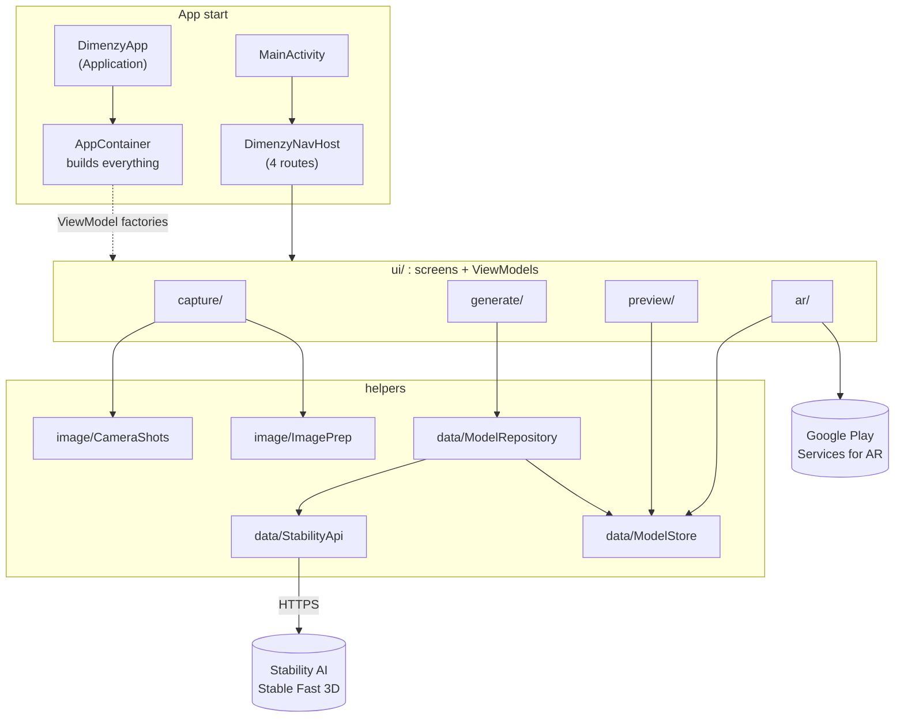
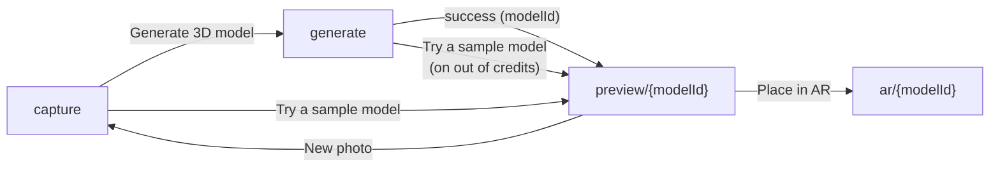
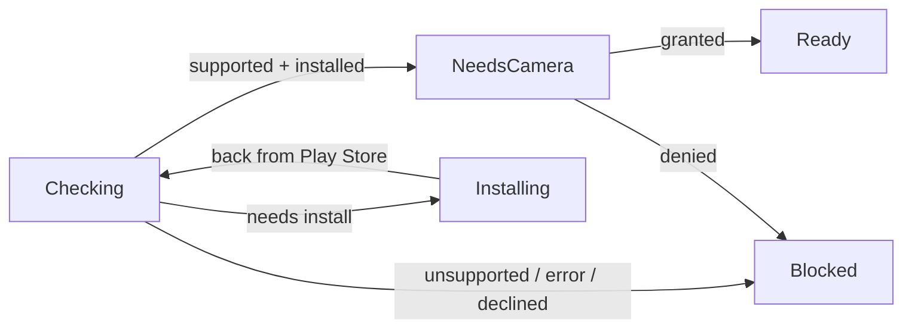
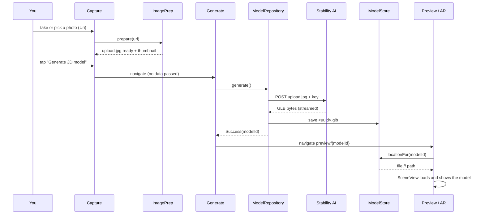

# Dimenzy Architecture

This file explains how the whole Dimenzy codebase works: what the app does, how it is built, how data moves through it, and what every folder and file is for. Read it top to bottom once and you should be able to find your way around the code.

For setup, build commands and the API key, see [README.md](README.md). For coding rules, see [AGENTS.md](AGENTS.md).

---

## 1. What the app does

Dimenzy is an Android app with one job, done in four steps:

1. **Capture:** you take a photo of an object, or pick one from your gallery.
2. **Generate:** the app sends the photo to an AI service (Stability AI **Stable Fast 3D**), which sends back a 3D model as a `.glb` file.
3. **Preview:** you see the model in a 3D view. You can spin it and zoom it.
4. **AR:** you place the model on a real floor or table through the phone camera (ARCore).

There is no login, no server of our own and no database. The app is the APK plus one HTTPS call. Five sample models are bundled, so the preview and AR work without an API key.

---

## 2. The big picture

The app is a **single Android module** (`app/`) written in **Kotlin** with **Jetpack Compose**. It uses a light **MVVM** pattern:

- **Screen** (a Compose function) draws the UI and sends taps to its ViewModel.
- **ViewModel** holds the screen's state in a `StateFlow` and does the work through helper classes.
- **Helpers** in `data/` and `image/` talk to the network, the file system and the photo.
- **`AppContainer`** builds all helpers once and hands them to ViewModels through their constructors. There is no DI framework (no Hilt, no Koin).



**Main libraries**

| Need | Library |
|---|---|
| UI | Jetpack Compose + Material 3 |
| Screens and Back | Navigation Compose |
| 3D view and AR | SceneView `arsceneview` 4.69.6 (Filament renders, ARCore tracks) |
| Network | Retrofit 3 + OkHttp 5 (no JSON: photo in, binary GLB out) |
| Photo rotation | `androidx.exifinterface` |

All versions live in [gradle/libs.versions.toml](gradle/libs.versions.toml).

---

## 3. How the app starts

1. Android creates **`DimenzyApp`** (the `Application`, named in the manifest). Its `onCreate` builds one **`AppContainer`**.
2. `AppContainer` creates nothing yet. Every helper is `by lazy`, so it is built the first time someone needs it.
3. Android opens **`MainActivity`**. It turns on edge to edge drawing, applies **`DimenzyTheme`**, and shows **`DimenzyNavHost`**, passing it the container.
4. `DimenzyNavHost` starts on the **capture** route.

What `AppContainer` builds:

| Object | What it is |
|---|---|
| `ModelStore` | Points at `filesDir/models/` |
| `ImagePrep` | Points at `cacheDir/upload.jpg` |
| `CameraShots` | Gives the camera a file to write into |
| `OkHttpClient` | 90 second timeouts, **no logging** (logging would print the API key) |
| `StabilityApi` | Retrofit client for `https://api.stability.ai/` |
| `ModelRepository` | Gets the API, the store, the upload file and `BuildConfig.STABILITY_API_KEY` |
| `ArCoreCheck` | Wraps ARCore's "is AR supported / installed?" calls |
| 4 ViewModel factories | One per screen, each passing in only what that screen needs |

---

## 4. Screens and navigation

There are four routes, defined in `Routes` inside [ui/DimenzyNavHost.kt](app/src/main/kotlin/com/dimenzy/app/ui/DimenzyNavHost.kt):

| Route | Screen | Gets |
|---|---|---|
| `capture` | `CaptureScreen` | nothing |
| `generate` | `GenerateScreen` | nothing (it reads `upload.jpg`) |
| `preview/{modelId}` | `PreviewScreen` | a `modelId` string |
| `ar/{modelId}` | `ArScreen` | a `modelId` string |



**Navigation rules**

- **Only ids cross routes.** Screens never pass bitmaps, 3D engines or models to each other. Each 3D screen loads the model again from its `modelId`.
- **Generate removes itself on success.** So Back from the preview goes to capture, not back into a finished upload.
- **"New photo"** pops back to the existing capture screen.
- **Double taps are ignored.** `dropUnlessResumed` (and a small `ifResumed` helper) drop a second tap once navigation has already started.
- **Animations.** Routes crossfade (350 ms). On top of that, a **shared transition** makes the photo look like one object moving: the capture photo panel shrinks into the "generating" card, and that card grows into the 3D preview. This lives in [ui/common/SharedTransitions.kt](app/src/main/kotlin/com/dimenzy/app/ui/common/SharedTransitions.kt).

---

## 5. The main flow, step by step

### Step 1: Capture (`ui/capture/`)

**What you see:** the app title, a square photo panel, a tip ("One object, plain background, good light"), the **Generate 3D model** button (once a photo is ready), **Take photo**, **Choose from gallery**, and **Try a sample model**.

**What happens:**

- **Take photo:** `rememberCameraPermission` asks for the camera permission if needed, then the system camera app opens. `CameraShots.outputUri()` gives it a private file, `cacheDir/photos/capture.jpg`, shared through a `FileProvider`. The URI is saved in `SavedStateHandle` so the result still works if Android killed the app while the camera was open.
- **Choose from gallery:** the Android Photo Picker opens. No storage permission is needed.
- Either way, `CaptureViewModel.onPhotoChosen(uri)` runs. The state goes **Empty → Preparing → Ready** (or back to Empty with an error).
- **`ImagePrep.prepare(uri)`** makes the one upload file:
  1. Reads only the image size first (cheap).
  2. Decodes at a reduced size (about 2048 px) so huge photos don't run out of memory.
  3. Scales the long side down to 1024 px.
  4. Rotates or flips it using the photo's EXIF tag, so it is upright.
  5. Saves it as JPEG (quality 90) to `upload.jpg.tmp`, then renames it to `cacheDir/upload.jpg`. A half written file never exists.
- A half size thumbnail is loaded for the panel and kept in memory, so the next screen can show it on its first frame.
- If the camera is denied, a short message with **Try again** and **Open settings** appears. Gallery still works.

**Nothing is sent yet.** The paid AI call only starts when you tap **Generate 3D model**.

### Step 2: Generate (`ui/generate/`)

**What you see:** a card with your photo, "Making your 3D model", an endless progress bar, and **Cancel**. On failure: the error message, **Retry**, **Choose another photo**, and (for out of credits) **Try a sample model**.

**What happens:**

- `GenerateViewModel` starts the call **once, in `init`**. Tapping Generate on the previous screen was the confirmation.
- **`ModelRepository.generate()`** (on the IO thread):
  1. Checks `upload.jpg` exists (else `MissingPhoto`).
  2. Asks `ModelStore` for new file names using a fresh UUID.
  3. Sends `POST v2beta/3d/stable-fast-3d` with header `authorization: Bearer <key>` and one multipart field, `image`.
  4. On a non-200 status, maps the code to a `GenerateError` (see section 7).
  5. On 200, **streams** the GLB bytes to `<uuid>.glb.tmp` (never all in memory), then renames it to `<uuid>.glb`.
  6. Copies the photo to `<uuid>.jpg` (best effort, for a future model library).
  7. Logs status, time and byte count under the tag `Dimenzy`. It never logs the key.
  8. Returns `Success(modelId)` or `Failure(error)`.
- **Cancel** (or Back) leaves the screen. That clears the ViewModel's scope, which cancels the coroutine. The byte copy checks for cancellation each chunk, so it stops right away, and the `.tmp` file is deleted.
- **Safety against paying twice:**
  - Screen rotation keeps the same ViewModel, so the call isn't started again.
  - `SavedStateHandle` remembers `started` and `result`. If Android kills and restores the app mid call, the screen shows `Interrupted` and waits for a **Retry** tap. If the result had already arrived, it goes straight to the preview.
  - **Retry** is the only way to resend, and only from the failed state.
- On `Done(modelId)`, the screen navigates to `preview/{modelId}`.

### Step 3: Preview (`ui/preview/`)

**What you see:** the model in a full screen 3D view, "Drag to spin, pinch to zoom", **Place in AR** and **New photo**.

**What happens:**

- `PreviewViewModel` reads `modelId` from the route and asks **`ModelStore.locationFor(modelId)`** for where the file is. It gets back either:
  - an asset path (for a sample, such as `samples/wolf.glb`),
  - a `file://` path (for a generated model), or
  - `null` (unknown id or missing file), which shows "Couldn't open this model." with Retry.
- **The 3D engine waits for the screen animation to finish** (`rememberRouteSettled`). Starting the engine blocks the main thread for a moment, which would otherwise make the card animation stutter.
- SceneView's `rememberModelLoadState` loads the GLB. The model is scaled to fit a 1 m box, and the camera orbits 3 m away.
- The view is a transparent `TextureView`, so the app background shows behind the model and the shared card animation draws correctly.
- When the model is ready, **`rememberModelSwing`** turns it one full circle over 4 seconds, then it stops where it started. This shows it's really 3D.
- **Retry** bumps a `reloadKey`, which throws away the old load and starts a new one.
- Sample models can have an animation clip (for example the wolf's `04_Idle`); `ModelStore.animationFor` gives its name.

### Step 4: AR (`ui/ar/`)

**What you see:** first a "Checking AR support…" screen, then the live camera with a placement ring. Tap a surface to place the model. Then size and rotation sliders, a hint line and **Reset** rise in from the bottom. A back button sits top left.

**What happens, part A: the readiness gate** ([ArReadiness.kt](app/src/main/kotlin/com/dimenzy/app/ui/ar/ArReadiness.kt))

Before any camera view, `rememberArReadiness` walks through these states:



- `ArCoreCheck.availability()` asks ARCore every 200 ms until it decides, and gives up after 10 s.
- If ARCore is missing, `ArCoreCheck.requestInstall()` opens the Google Play Services for AR install screen.
- The check **runs again on every resume**, and the camera permission is read live. The app never trusts a saved "AR is fine" value, because the user can change things in Settings while away.
- `Blocked(ArError)` shows a message plus the right buttons (Install, Retry, Try again, Open settings, Back to 3D view).

**What happens, part B: placing the model** ([ArPlacement.kt](app/src/main/kotlin/com/dimenzy/app/ui/ar/ArPlacement.kt))

- `ArViewModel` resolves `modelId` through `ModelStore`, the same way as the preview.
- The camera view starts **while the model still loads**, so plane scanning isn't wasted. A "Loading model" pill shows meanwhile.
- SceneView's **`PlacementScene`** finds horizontal surfaces (floors, tables), shows coaching hints, draws ground shadows, and uses ARCore's environment lighting.
- **Every tap adds an anchor. The model is drawn only at the newest one,** so tapping somewhere else moves it there.
- The model starts with its longest side at **0.4 m**.
- **Gestures:** drag moves the model along surfaces, pinch resizes it, twist rotates it.
- **Sliders:**
  - `ModelSize` + `SizeSlider`: 25% to 400% of the start size. The slider is logarithmic, so 100% sits in the middle. Pinch updates the slider when the pinch ends.
  - `ModelRotation` + `RotationSlider`: -180° to +180° around the vertical axis. A twist updates the slider when the twist ends.
  - These two classes hold a reference to the placed node, so the sliders (outside the 3D scene) can change it. Only the bottom controls recompose when a slider moves, not the whole AR scene.
- **Reset** clears all anchors.
- **`TapThroughReticle`** is our own copy of SceneView's placement ring. The built-in ring catches taps, so tapping on it (where people naturally tap) placed nothing. Ours looks the same but lets taps pass through to the surface below.

---

## 6. Data flow: where data lives

### Files on the phone

| Path | Written by | Read by | Notes |
|---|---|---|---|
| `cacheDir/photos/capture.jpg` | System camera app (via `FileProvider`) | `ImagePrep` | Overwritten on every shot. The only folder the `FileProvider` exposes. |
| `cacheDir/upload.jpg` | `ImagePrep` | `ModelRepository`, thumbnails | The **one** photo that gets uploaded. Written via `.tmp` then rename. |
| `filesDir/models/<uuid>.glb.tmp` | `ModelRepository` | nobody | The download in progress. Deleted if anything fails. |
| `filesDir/models/<uuid>.glb` | `ModelRepository` | Preview, AR (via `ModelStore`) | A finished model. Only exists if the download fully completed. |
| `filesDir/models/<uuid>.jpg` | `ModelRepository` | nobody yet | Copy of the photo, kept for a future model library. |
| `assets/sample.glb`, `assets/samples/*.glb` | packed in the APK | Preview, AR | The five sample models (shrunk with Draco compression). |

`ModelStore.locationFor()` is the **only** place that turns a `modelId` into a file. It accepts a fixed sample id, or a **proper UUID** only, so a route argument like `../../something` can never reach a file outside `filesDir/models/`.

### State in memory

- Each ViewModel exposes one `StateFlow` (for example `CaptureUiState`, `GenerateUiState`, `PreviewTarget`, `ArTarget`). Screens collect it with `collectAsStateWithLifecycle`.
- **`SavedStateHandle`** keeps the few values that must survive Android killing the app:

| ViewModel | Key | Meaning |
|---|---|---|
| `CaptureViewModel` | `photoReady` | A prepared photo exists (only trusted if the file is really there) |
| `CaptureViewModel` | `pendingCameraUri` | Where the camera is writing the current shot |
| `GenerateViewModel` | `started` | The paid call was sent |
| `GenerateViewModel` | `result` | The `modelId` once it succeeded |
| Preview / AR | `modelId` | Comes from the route |

- Small UI-only flags (is the sample sheet open, permission state) use `rememberSaveable` in the screen.

### One trip through the app



---

## 7. Errors

Every failure becomes a case of a **sealed type**. The UI never sees a raw exception, and each type has **one** function that turns it into English text with next steps.

| Area | Sealed type | File | Text lives in |
|---|---|---|---|
| Photo prep | `PhotoError` (`Unreadable`) | `image/PhotoError.kt` | `CaptureScreen` |
| Generation | `GenerateError` | `data/GenerateError.kt` | `ui/generate/GenerateErrorText.kt` |
| AR | `ArError` | `ui/ar/ArError.kt` | same file (`ArError.message()`) |

**How a generation result maps to `GenerateError`** (in `ModelRepository`):

| What happened | Error |
|---|---|
| `upload.jpg` missing | `MissingPhoto` |
| HTTP 400, 422 | `BadImage` |
| HTTP 401 (also a blank key) | `BadKey` |
| HTTP 402 | `OutOfCredits` |
| HTTP 403 | `Refused` |
| HTTP 429 | `RateLimited` |
| HTTP 5xx | `Server` |
| `SocketTimeoutException`, `InterruptedIOException` | `Timeout` (caught **before** `IOException`) |
| any other `IOException` | `NoNetwork` |
| restored mid call, no result | `Interrupted` |
| anything else | `Unexpected(code)` |

`CancellationException` is always re-thrown, never turned into an error, so Cancel stays silent.

**AR errors:** `Unsupported`, `InstallDeclined`, `CheckFailed`, `CameraDenied`, `ModelLoadFailed`.

---

## 8. Folder and file guide

### Repository root

```
dimenzy/
├── app/                  The Android app (the only Gradle module)
├── docs/                 Scope and design specs
├── marketing/            README hero animation and visuals (React, not part of the app)
├── gradle/               Gradle wrapper + libs.versions.toml (all dependency versions)
├── .claude/skills/       Reference skills for AI tools (SceneView APIs, Android security, ...)
├── assets/               Original, full size sample models (git ignored, local only)
├── build.gradle.kts      Root build file (declares plugins only)
├── settings.gradle.kts   Module list and repositories
├── gradle.properties     Gradle and Android flags
├── local.properties      SDK path, API key, signing values (git ignored, never commit)
├── README.md             What the app is, how to build it, API details
├── AGENTS.md / CLAUDE.md Coding rules and commands for contributors and AI tools
└── ARCHITECTURE.md       This file
```

### `app/`

| Path | What it holds |
|---|---|
| `build.gradle.kts` | SDK levels, puts `STABILITY_API_KEY` into `BuildConfig`, release signing from `local.properties`, R8 off |
| `src/main/AndroidManifest.xml` | `CAMERA` + `INTERNET` permissions, AR marked **optional**, portrait only, the private `FileProvider` |
| `src/main/assets/` | The five bundled sample `.glb` models |
| `src/main/res/drawable/` | Vector icons (back arrow, rotate, zoom) and the launcher icon layers |
| `src/main/res/mipmap-*/` | Launcher icons per screen density |
| `src/main/res/values/` | App name and the base XML theme |
| `src/main/res/xml/file_paths.xml` | Tells the `FileProvider` to expose only `cacheDir/photos/` |
| `src/main/res/xml/backup_rules.xml`, `data_extraction_rules.xml` | Android backup settings (template defaults) |

### `app/src/main/kotlin/com/dimenzy/app/`

**Top level**

| File | Job |
|---|---|
| `DimenzyApp.kt` | The `Application` class and **`AppContainer`**, which builds and wires every dependency |
| `MainActivity.kt` | The only Activity. Sets theme, edge to edge, and shows the nav host |

**`data/`: network and storage**

| File | Job |
|---|---|
| `StabilityApi.kt` | Retrofit interface: one `POST` with the photo, returns the GLB stream |
| `ModelRepository.kt` | Runs one generation: upload, map errors, stream to disk safely, log |
| `ModelStore.kt` | Makes new model file names and turns a `modelId` into a file or asset path |
| `SampleModels.kt` | The list of the five bundled models (id, name, description, asset path, animation) |
| `GenerateError.kt` | `GenerateError` (all generation failures) and `GenerateOutcome` (Success / Failure) |

**`image/`: photo prep**

| File | Job |
|---|---|
| `ImagePrep.kt` | Turns any photo into an upright, 1024 px JPEG at `cacheDir/upload.jpg`, plus thumbnails |
| `CameraShots.kt` | Gives the system camera a private `FileProvider` URI to write into |
| `PhotoError.kt` | `PhotoError` and `PhotoOutcome` (Ready / Failed) |

**`ui/`: screens**

| File | Job |
|---|---|
| `DimenzyNavHost.kt` | The four routes, back stack rules, route fades, and shared transition setup |

`ui/capture/`

| File | Job |
|---|---|
| `CaptureScreen.kt` | Layout and buttons; launches the camera and photo picker |
| `CaptureViewModel.kt` | Photo state (Empty / Preparing / Ready), calls `ImagePrep`, remembers the camera URI |
| `PhotoPanel.kt` | The square frame: empty hint, spinner, or the photo |

`ui/generate/`

| File | Job |
|---|---|
| `GenerateScreen.kt` | Shows the working card or the error with Retry; jumps to preview on success |
| `GenerateViewModel.kt` | Starts the paid call once, guards against resending, holds Working / Done / Failed |
| `WorkingCard.kt` | The card with the photo thumbnail and progress bar |
| `GenerateErrorText.kt` | Turns each `GenerateError` into a user message |

`ui/preview/`

| File | Job |
|---|---|
| `PreviewScreen.kt` | The SceneView 3D view, loading/failed states, Place in AR and New photo |
| `PreviewViewModel.kt` | Resolves `modelId` to a location; Retry reloads |
| `ModelSwing.kt` | The one full turn the model makes when it first appears |

`ui/ar/`

| File | Job |
|---|---|
| `ArScreen.kt` | Top of the AR screen: readiness gate, model loading, blocked screens, back button |
| `ArViewModel.kt` | Resolves `modelId` to a location; Retry reloads |
| `ArCoreCheck.kt` | Asks ARCore if AR is supported and installed; asks to install it |
| `ArReadiness.kt` | The gate's state machine (Checking, Installing, NeedsCamera, Ready, Blocked), rechecked on resume |
| `ArError.kt` | All AR failures and their messages |
| `ArPlacement.kt` | The live camera scene: plane finding, tap to place, gestures, bottom controls, Reset |
| `TapThroughReticle.kt` | Our placement ring that doesn't block taps |
| `ModelSize.kt` | Links the size slider and pinch to the placed model (0.25x to 4x) |
| `ModelRotation.kt` | Links the rotation slider and twist to the placed model (-180° to 180°) |
| `SizeSlider.kt` | The size slider UI (logarithmic) |
| `RotationSlider.kt` | The rotation slider UI |

`ui/common/`: shared pieces

| File | Job |
|---|---|
| `CameraPermission.kt` | Asks for the camera, rechecks it on every resume, opens app Settings |
| `SamplePickerSheet.kt` | Bottom sheet listing the sample models |
| `SharedTransitions.kt` | The photo card / photo shared animations, and `rememberRouteSettled` |
| `DimenzyOutlinedButton.kt` | The app's secondary button style |

`ui/theme/`

| File | Job |
|---|---|
| `Color.kt` | Light and dark color tokens (Material Theme Builder, source color `#00668B`) |
| `Theme.kt` | `DimenzyTheme`: picks light or dark scheme (dynamic color is off) |
| `Type.kt` | Text styles (system default font) |

### `docs/`

| Path | What it holds |
|---|---|
| `scope/scope.md` | The feature list, order, and status (what's done, what's next) |
| `specs/0001-android-stack-architecture/` | Why this stack and architecture were chosen |
| `specs/0002-photo-to-3d-model.md` | Design of capture and generate, the error table |
| `specs/0003-place-model-in-ar.md` | Design of the AR screen and readiness gate |

### `marketing/`

A separate small React + Vite project that renders the README hero animation (photo → 3D → AR). It does not ship in the APK. `kit/` is a shared UI kit, `dimenzy-hero/` is the animation and its exported GIF/WebP/MP4/PNG, and `tools/render-model/` renders a `.glb` to images. See [marketing/README.md](marketing/README.md).

---

## 9. Key design choices and why

| Choice | Why |
|---|---|
| One `AppContainer`, constructor injection | Easy to read and follow; no framework magic for a small app |
| One ViewModel per screen, `StateFlow` out | The screen just draws the current state |
| Only `modelId` crosses routes | 3D engines and bitmaps are heavy and tied to one screen; ids survive process death |
| Write to `.tmp`, then rename | A crash or cancel never leaves a broken photo or model that looks valid |
| Stream the GLB to disk | Models can be many MB; never hold them in memory |
| Start the paid call in `init`, resend only on tap | You never pay twice by accident (rotation, restore, double tap) |
| Sealed error types with one message function each | Every failure has a clear message and a next step; no raw exceptions on screen |
| Recheck permission and ARCore on resume | The user can change them in Settings at any time |
| AR is optional in the manifest | Phones without ARCore can still install the app and use the 3D preview |
| Engine starts after the route animation | Keeps the screen transition smooth |
| No HTTP logging | It would print the API key into Logcat |
| R8 off | Filament and Retrofit need keep rules; kept simple for now (bigger APK) |

---

## 10. Build and configuration (short)

- **Config:** `local.properties` holds `sdk.dir`, `STABILITY_API_KEY`, and the four `RELEASE_*` signing values. The key is compiled into `BuildConfig.STABILITY_API_KEY`. A blank key still builds; generation then shows the "API key problem" message.
- **Build:** `./gradlew assembleDebug`, `./gradlew installDebug`, `./gradlew assembleRelease`. Gradle needs JDK 21.
- **Tests:** there is no automated test suite. A change is checked by installing on a phone. Filter Logcat by the tag `Dimenzy`.
- **Platform:** `minSdk 24`, `compileSdk`/`targetSdk 37`, portrait only, English only.

---

## 11. Where to add new things

| You want to... | Start here |
|---|---|
| Add a new screen | New `ui/<name>/` folder with `XxxScreen` + `XxxViewModel`, a factory in `AppContainer`, a route in `DimenzyNavHost` |
| Add a saved model library (planned feature 6) | `ModelStore` already saves `<uuid>.glb` and `<uuid>.jpg`; add a "list" and "delete" there and a new `ui/library/` screen |
| Set a real height in AR (planned feature 7) | `START_SIZE_METERS` in `ArPlacement.kt` and `ModelSize` |
| Add or change a sample model | Put the `.glb` in `app/src/main/assets/samples/` and add a line to `SAMPLE_MODELS` |
| Change error wording | `GenerateErrorText.kt` or `ArError.message()` |
| Add a new failure case | Add a case to the right sealed type, map it where it happens, add its message |
| Use a SceneView API | Check `.claude/skills/sceneview/` first; don't guess names |
