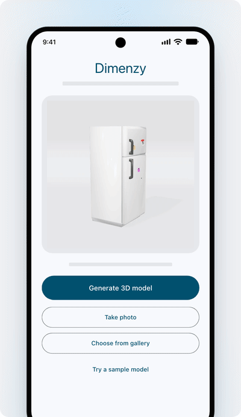
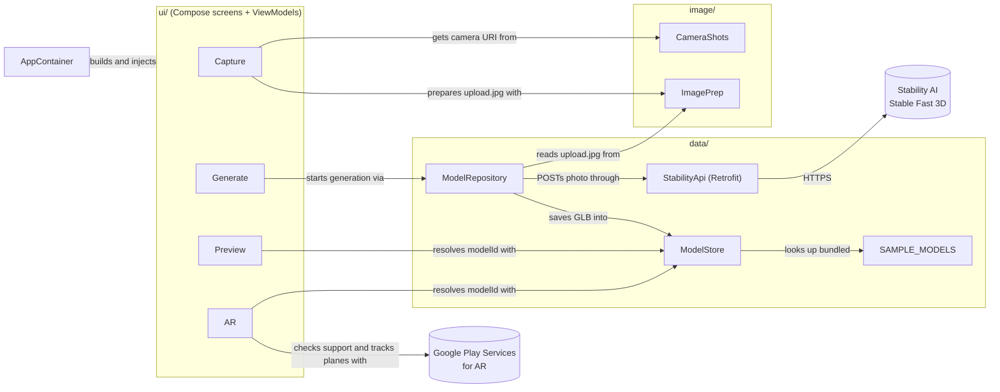
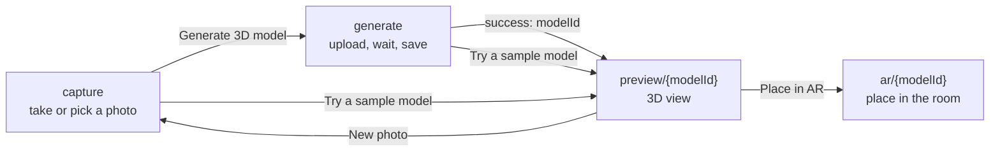
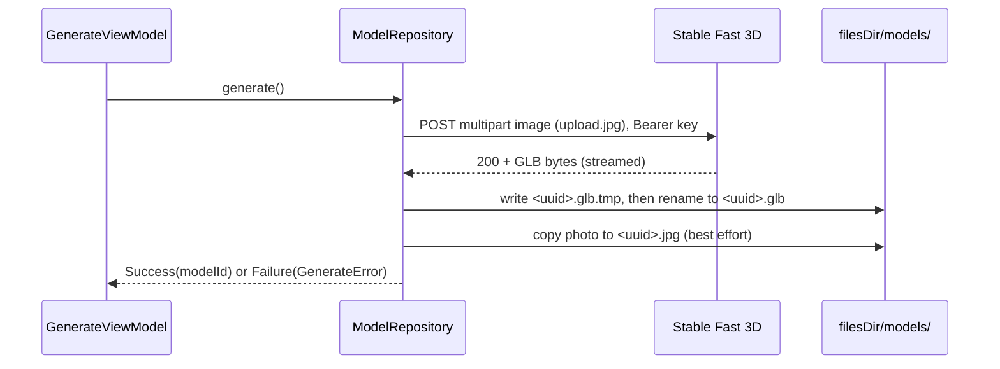

# Dimenzy

<p align="center"></p>

Dimenzy is an Android app that turns a photo of an object into a 3D model you can place in your room. You take or pick a photo, an AI service (Stability AI **Stable Fast 3D**) builds a textured `.glb` model from it, and you look at it in a 3D preview or put it on a real floor or table with augmented reality (ARCore).

It's a college project: no accounts, no backend, just the APK plus one HTTPS call.

**Key features**

- **Photo in:** take a photo with the system camera or choose one from the gallery. The app straightens and shrinks it before upload.
- **3D model out:** one call to Stable Fast 3D returns a GLB, which is saved on the phone.
- **3D preview:** the model turns once to show every side, then you drag to orbit and pinch to zoom.
- **Place in AR:** drop the model on a detected floor or table. Drag to move it, pinch or use a slider to resize it, twist or use a slider to rotate it, and tap elsewhere to move it there.
- **Sample models:** five bundled models (some animated) so you can try the 3D preview and AR without an API key or credits.
- **Clear errors:** every failure (no internet, out of credits, AR not supported, camera denied, and so on) shows a plain message with a way to retry.

**Likely uses:** a demo of photo to 3D to AR on your own phone, checking how an object would look in a room, or a small, readable reference app for SceneView, ARCore and Compose.

## Table of Contents

- [Architecture](#architecture)
- [Repository Structure](#repository-structure)
- [Dependencies and Integration](#dependencies-and-integration)
- [API Documentation](#api-documentation)
- [Development Notes](#development-notes)
- [Known Issues and Limitations](#known-issues-and-limitations)
- [Additional Documentation](#additional-documentation)

## Architecture

### Technology stack

| Layer | Choice |
|---|---|
| Language | Kotlin 2.4 with coroutines and `StateFlow`, JDK 21 |
| UI | Jetpack Compose + Material 3, portrait only |
| Navigation | Navigation Compose (4 routes) |
| 3D and AR | [SceneView](https://github.com/sceneview/sceneview) `arsceneview` 4.69.6 (Filament rendering, ARCore placement) |
| Networking | Retrofit 3 + OkHttp 5, no JSON converter (the response is a binary GLB) |
| Image prep | `BitmapFactory` + `androidx.exifinterface` |
| Build | Gradle 9.8 wrapper, AGP 9.4, version catalog in `gradle/libs.versions.toml` |
| Platform | `minSdk 24` (Android 7.0), `compileSdk` and `targetSdk` 37 |

### How the pieces fit

It's a single `app` module with light MVVM: one `ViewModel` per screen, a small data layer, and a hand written `AppContainer` (in `DimenzyApp.kt`) that builds everything and passes it in through constructors. There's no DI framework.



### Screen flow

Screens pass only a `modelId` string between routes, never bitmaps, engines or models. Each 3D screen creates its own SceneView engine and loads the model itself.



The `generate` route removes itself from the back stack once it succeeds, so Back from the preview goes straight to the capture screen.

### Generating a model



### Key design patterns

- **Constructor injection through one container.** `AppContainer` builds every dependency lazily and hands out `ViewModelProvider.Factory` objects. No service locator, no global singletons beyond the container.
- **Sealed error types per area.** Every failure becomes a case of `GenerateError`, `PhotoError` or `ArError`, which the UI turns into a message with Retry. Screens never see raw exceptions.
- **Safe file writes.** Photos and GLBs are written to a temp file and renamed only when complete, so a broken download never leaves a half file that looks valid.
- **One paid request at a time.** The generate call runs in `viewModelScope`, so rotation or recomposition never starts a second request. Only a Retry tap resends.
- **Ids only across routes.** `ModelStore.locationFor(modelId)` is the single mapping from an id to a model file. It accepts only canonical UUIDs (or the fixed sample ids), so a route argument can never point outside `filesDir/models/`.
- **Check real state on resume.** The AR screen checks ARCore availability and camera permission every time it resumes, instead of trusting a saved value.

## Repository Structure

```
dimenzy/
├── app/
│   ├── build.gradle.kts           App build: SDK levels, BuildConfig key, release signing
│   └── src/main/
│       ├── AndroidManifest.xml    Camera + internet permissions, optional ARCore, FileProvider
│       ├── assets/                Bundled sample GLBs (sample.glb, samples/*.glb)
│       ├── kotlin/com/dimenzy/app/
│       │   ├── DimenzyApp.kt      Application + AppContainer (dependency wiring)
│       │   ├── MainActivity.kt    Hosts the Compose NavHost
│       │   ├── data/              Stability API, ModelRepository, ModelStore, samples, GenerateError
│       │   ├── image/             ImagePrep (EXIF rotate, downscale, JPEG), camera output URI
│       │   └── ui/
│       │       ├── capture/       Take or pick a photo
│       │       ├── generate/      Progress, errors, retry
│       │       ├── preview/       3D preview (SceneView)
│       │       ├── ar/            AR readiness gate, placement, size and rotation sliders
│       │       ├── common/        Camera permission, sample picker, shared transitions
│       │       └── theme/         Material 3 colors, type, theme
│       └── res/                   Icons, launcher icon, strings, FileProvider paths
├── assets/                        Original (unshrunk) sample models
├── docs/
│   ├── scope/scope.md             Feature list and status
│   └── specs/                     Design decisions (0001 stack, 0002 photo to 3D, 0003 AR)
├── marketing/                     README hero and product visuals (React + CSS, separate from the app)
├── gradle/libs.versions.toml      Dependency versions
└── AGENTS.md                      Project conventions for AI tools and contributors
```

## Dependencies and Integration

| Service | Used for | Notes |
|---|---|---|
| **Stability AI, Stable Fast 3D** (`https://api.stability.ai/`) | Turning the photo into a GLB model | Needs a Stability API key and credits. Each successful run costs credits; failed runs are free. The app needs internet only for this step. |
| **Google Play Services for AR** (ARCore) | Plane detection and placement on the AR screen | Optional. Phones without ARCore can still install the app and use the 3D preview; the AR screen then shows "AR isn't supported on this phone." If ARCore is supported but missing, the app offers to install it. |
| **System camera app** | Taking the photo | Launched through `ActivityResultContracts.TakePicture`, writing into the app's private `FileProvider` folder. |
| **Android Photo Picker** | Choosing a gallery photo | No storage permission needed. |

There's no backend, database, message queue or event stream. Generated models live in the app's private storage at `filesDir/models/<uuid>.glb`.

## API Documentation

Dimenzy doesn't expose an API. It makes one outbound call, defined in `data/StabilityApi.kt`.

### `POST https://api.stability.ai/v2beta/3d/stable-fast-3d`

| Part | Value |
|---|---|
| Header | `authorization: Bearer <STABILITY_API_KEY>` |
| Body | `multipart/form-data` with one field, `image`: the prepared `upload.jpg` (EXIF upright, long side 1024 px, JPEG quality 90) |
| Other fields | Left at the service defaults |
| Timeouts | 90 s for connect, read, write and the whole call |
| Success | `200` with the GLB binary as the body, streamed straight to disk |

### How responses become messages

`ModelRepository` maps every result to a `GenerateError`, and `ui/generate/` shows a message with Retry.

| Response | `GenerateError` |
|---|---|
| `400`, `422` | `BadImage` |
| `401` | `BadKey` (also what you get with a blank key) |
| `402` | `OutOfCredits` |
| `403` | `Refused` (content moderation) |
| `429` | `RateLimited` |
| `5xx` | `Server` |
| `SocketTimeoutException`, `InterruptedIOException` | `Timeout` |
| Any other `IOException` | `NoNetwork` |
| Anything else (including `413`) | `Unexpected(code)` |
| `upload.jpg` missing | `MissingPhoto` |
| Screen restored after the call started with no result | `Interrupted` (never resent without a tap) |

## Development Notes

### Requirements

- Android Studio (its bundled JDK 21 works for Gradle)
- An Android phone with USB debugging on. For AR, the phone must [support ARCore](https://developers.google.com/ar/devices).
- A Stability AI API key if you want to generate models (the samples work without one)

### Configuration

Put these in `local.properties` at the repo root. It's git ignored, so never commit it.

```properties
sdk.dir=/path/to/Android/sdk
STABILITY_API_KEY=sk-...

# Only needed for a signed release APK
RELEASE_STORE_FILE=/path/to/your-release.jks
RELEASE_STORE_PASSWORD=...
RELEASE_KEY_ALIAS=...
RELEASE_KEY_PASSWORD=...
```

The key is compiled into `BuildConfig.STABILITY_API_KEY`. A blank key still builds; generation then fails with the "bad key" message. If any of the four `RELEASE_*` values is missing, the release build comes out unsigned.

### Build and run

```bash
# Gradle needs JDK 21 (Android Studio's bundled one works)
export JAVA_HOME="/Applications/Android Studio.app/Contents/jbr/Contents/Home"

./gradlew assembleDebug      # build a debug APK
./gradlew installDebug       # build and install on the USB phone
./gradlew assembleRelease    # signed release APK in app/build/outputs/apk/release/
./gradlew lint               # Android Lint
~/Library/Android/sdk/platform-tools/adb devices -l   # is the phone visible?
```

A debug build and a release build are signed with different keys, so you have to uninstall one before installing the other (this deletes saved models).

### Testing

There's no automated test suite. A change counts as working when `installDebug` succeeds and you've checked it on the phone. For debugging, filter Logcat by the tag `Dimenzy`: it logs the HTTP status, timing and byte count of each generation, and never the key.

### Conventions

- Small classes with one job (aim for under 200 lines), dependencies through constructors, wired in `AppContainer`.
- Folders by feature: `ui/<screen>/` holds `XxxScreen` and `XxxViewModel`.
- No `!!` and no unchecked casts in app code.
- Catch `SocketTimeoutException` before `IOException`.
- Follow the SceneView skill in `.claude/skills/sceneview/` for SceneView API names rather than guessing.

See [AGENTS.md](AGENTS.md) for the full list.

### Performance notes

- Photos are never fully decoded: `ImagePrep` reads the bounds first and subsamples to about 2048 px before scaling to 1024 px, so huge camera photos don't run out of memory.
- The GLB response is streamed to disk (`@Streaming`), never held in memory, and the copy stops as soon as you cancel.
- The AR sliders read their state in the bottom controls only, so moving a slider recomposes the controls and not the AR scene.
- R8 shrinking is off, so the release APK is large (about 72 MB, mostly the SceneView/Filament libraries and the sample models).

## Known Issues and Limitations

- **The API key is inside the APK.** Anyone with the APK can extract it. Rotate or revoke the key after a demo.
- **One AI provider, no fallback.** If Stability AI is down or you're out of credits, only the samples and models you already generated work.
- **Model quality depends on the photo.** There's no background cutout step, so a single object on a plain background works best.
- **No model library yet.** Generated models are saved to disk (with a copy of the photo for future thumbnails), but there's no screen to list, reopen or delete them. That's planned as feature 6.
- **Fixed start size in AR.** Every model starts with its longest side at 0.4 m. Typing a real height is planned as feature 7.
- **R8 is off**, which keeps the release APK large. Turning it on would need keep rules for Filament and Retrofit.
- **Backup rules are the template defaults.** `res/xml/data_extraction_rules.xml` still has its template `TODO`, and `allowBackup` is on.
- **English only, portrait only.**
- **Not built yet:** background cutout preview, sharing or exporting the model, several models in one scene, and AI size estimates (all deferred in the scope).

## Additional Documentation

- [AGENTS.md](AGENTS.md): stack, commands, configuration and coding rules
- [docs/scope/scope.md](docs/scope/scope.md): features, status and what's planned next
- [docs/specs/0001-android-stack-architecture/index.md](docs/specs/0001-android-stack-architecture/index.md): stack and architecture decision
- [docs/specs/0002-photo-to-3d-model.md](docs/specs/0002-photo-to-3d-model.md): the photo to 3D model flow
- [docs/specs/0003-place-model-in-ar.md](docs/specs/0003-place-model-in-ar.md): AR placement and the AR readiness gate
- [marketing/README.md](marketing/README.md): how the README hero and other visuals are made, plus asset credits

The fridge model in the hero animation and the bundled samples is "House Props : Fridge" by Whitend ([Sketchfab](https://sketchfab.com/3d-models/house-props-fridge-2fdaa56bbd85404cb4206dcaedc16658), CC BY 4.0).
